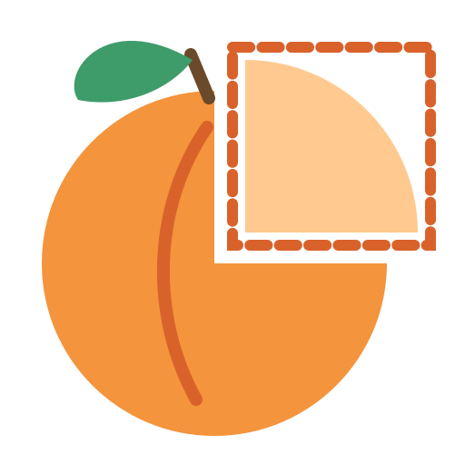

<p align="center">
  
</p>

<h1 align="center">Snapricot</h1>

<p align="center"><b>Snap it. Mark it. Share it.</b><br/>
A fast, free, open-source screenshot and annotation tool. <i>(pronounced SNAP-ri-kot)</i></p>

---

> **Status:** early development (Phase 1 of the [roadmap](docs/plan/roadmap.md): Windows capture works). v1.0 targets Windows; macOS follows in v2.0.

## Planned features

- Region, window, and full-screen capture with global hotkeys
- Capture overlay with magnifier and pixel-exact selection across multi-monitor, mixed-DPI setups
- Annotation editor: arrows, shapes, text, highlighter, blur/pixelate, numbered steps, crop
- Instant copy to clipboard, auto-save, and a searchable history
- Later: OCR (copy text from screen), pin to screen, GIF recording, macOS

## Built to be light

| | Budget |
|---|---|
| Startup | < 300 ms (Native AOT) |
| Idle memory | < 60 MB |
| Hotkey to overlay | < 100 ms |

Details: [docs/architecture/performance.md](docs/architecture/performance.md)

## Architecture

Every feature is a self-contained **module** that plugs into a thin Avalonia shell; modules talk only through an
in-process event bus, and OS code lives behind platform interfaces.

```
Snapricot.App ──► Snapricot.Modules.* ──► Snapricot.Core ◄── Snapricot.Platform.{Windows,MacOS}
```

- [Architecture overview](docs/architecture/overview.md) · [Adding a module](docs/architecture/adding-a-module.md)
- [Architecture decision records](docs/adr/README.md)

## Build from source

Requires the [.NET 10 SDK](https://dotnet.microsoft.com/download).

```bash
dotnet build Snapricot.slnx
dotnet test --solution Snapricot.slnx
dotnet run --project src/Snapricot.App
```

Native AOT release build (Windows needs the Visual Studio **Desktop development with C++** workload):

```bash
dotnet publish src/Snapricot.App -c Release -r win-x64 -o artifacts/publish/win-x64
```

## Free and open source

Snapricot is free, with no ads, no account, and no telemetry. Captures never leave your machine unless you choose to share them.

## Tech

.NET 10 · Avalonia 12 · CommunityToolkit.Mvvm · Microsoft.Extensions.DependencyInjection · xUnit v3 · GitHub Actions

## License

[MIT](LICENSE) © 2026 Waqas Ahmad
