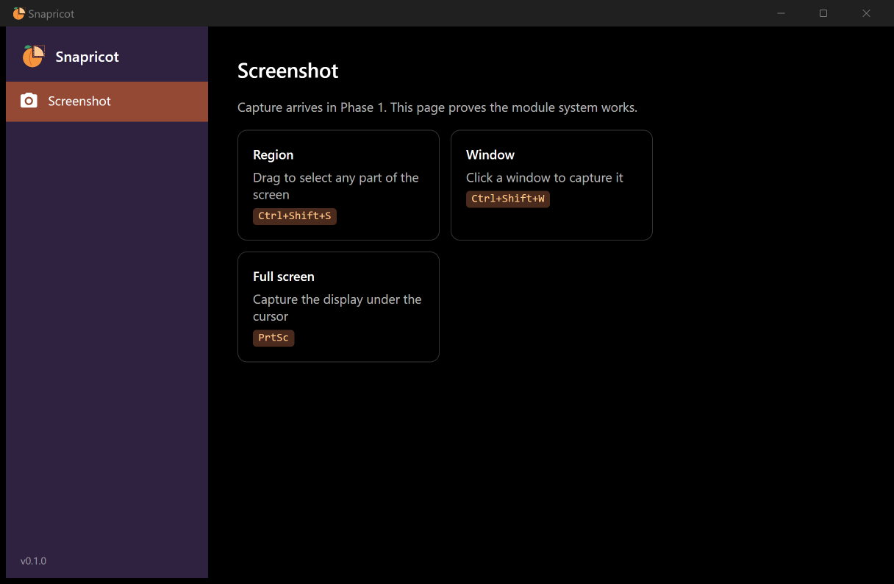

# Project status

> The single source of truth for "where are we?". Update it at the end of every working session.

**Current phase:** Phase 1 (Capture): in progress
**Next phase:** History module, then Phase 2 (Editor)
**Target:** v1.0 (Windows) about 8 weeks after Phase 1 starts, at ~8–10 hours per week

## Phase 0 checklist

- [x] Name chosen: Snapricot ([vision](product/vision.md))
- [x] UI mockups agreed ([design](product/design.md))
- [x] Brand: logo (apricot with a snapped slice) and palette ([brand](product/brand.md))
- [x] Build and marketing plan written ([roadmap](plan/roadmap.md), [marketing](plan/marketing.md))
- [x] Hosting and business decisions ([hosting](plan/hosting-and-distribution.md), [business model](plan/business-model.md))
- [x] Architecture decided and recorded (ADR-0001 to ADR-0010)
- [x] Solution scaffold: Core, Platform.Windows, Platform.MacOS, App, Screenshot module
- [x] Module system: `ISnapricotModule`, `IModuleBuilder`, `ModuleLoader`, `ModuleCatalog`
- [x] In-process event bus with tests
- [x] Shell: light theme, sidebar built from modules (apricot selection), lazy pages, tray icon (closing hides to tray)
- [x] Brand colors as app resources (`BrandApricotDeepBrush`, `BrandPlumBrush`, `BrandTintBrush`, ...)
- [x] Unit tests (13) and architecture tests (6) passing
- [x] `--measure-startup` diagnostics switch
- [x] CI workflow: build + test on Windows and macOS, Native AOT publish and startup measurement on Windows
- [ ] Install the VS "Desktop development with C++" workload locally to verify the AOT build and its startup time
- [x] Local git identity and `origin` set to the personal account (`waqasahmaddev`), the same as `flow`
- [x] Public repo `waqasahmaddev/snapricot` created; first commit pushed by the owner (**the owner commits; agents don't**)
- [x] CI green on the first push (Windows build+test, macOS build+test, Native AOT publish)
- [ ] Record the first AOT startup, memory, and size numbers from the CI job summary in performance.md
- [ ] Repo settings: protect `main`, add topics, enable Discussions, social preview image
- [ ] Check domain availability (snapricot.app / snapricot.com); buy before the v1.0 launch, not now

## Known issues and notes

- **Local Native AOT publish fails** with "Platform linker not found" until the C++ workload is installed.
  The IL compilation step produced no AOT/trim warnings. CI runners already have the linker.
- Debug (JIT) baseline on the dev machine: **~1.28 s to window open, ~90 MB working set**. This is not the release
  number; budgets apply to the AOT build (see [performance](architecture/performance.md)).
- The kickoff mockups use the old palette; [brand.md](product/brand.md) overrides them.
- **Light theme decided:** white app, warm off-white sidebar, solid apricot selection, apricot tint on hover (see brand.md). The owner can still change these.
- An **About** module was added (`Snapricot.Modules.About`). The 4 extra tests come from it being registered in the architecture tests (23 tests total).

## Session log

Newest first. One entry per session: what changed and what's next.

### 2026-10-09 (later): Brand refresh, hosting, and business plan
- The first logo (orange square with corner brackets) looked too much like Icecream Screen Recorder. Replaced it with an
  **apricot with one slice snapped out inside a dashed selection frame**: no tile, no brackets. SVG source plus a small mark
  for 32 px and below; PNGs come from `tools/brand/Render-Logo.ps1`.
- New palette: Apricot `#F4943C`, Apricot deep `#D9622B` (UI accent), Flesh `#FFC98F`, Leaf `#3E9B6A`, Plum `#2E2240` (sidebar).
  Applied as resource keys in `App.axaml`; the Screenshot module now uses the keys instead of hex values.
- Decided: **public** GitHub repo under a `snapricot` organization; free hosting (GitHub Pages, Releases, Actions); buy a domain
  just before v1.0. Free/MIT now, open-core Pro later (ADR-0010, Proposed).
- **Next:** create the GitHub organization, then the first commit and push, then Phase 1.

### 2026-10-09: Project kickoff
- Picked the name Snapricot. Designed the mockups (capture overlay, editor, tray, settings, main window in the style of Icecream Screen Recorder).
- Decided: Windows first, macOS-ready; modular "everything is a module" architecture; Native AOT and performance budgets.
- Scaffolded the solution, module system, event bus, shell with tray, Screenshot module placeholder, tests, CI, and all docs/ADRs.

### 2026-10-09 (Phase 1 start): Windows capture implemented, not yet tried by hand
- Core: `PixelPoint`, `PixelBounds` helpers, `ImageOperations.Crop`, `FileNamePattern`, `HotkeyGesture` parser, `IDesktopService`; `IHotkeyService.RegisterAsync` is now async.
- Platform.Windows: GDI `BitBlt` capture with per-monitor DPI, display enumeration, foreground window bounds, `RegisterHotKey` and CF_DIB clipboard on a dedicated Win32 message thread. macOS: placeholders that throw `PlatformNotSupportedException`.
- Screenshot module: `CaptureCoordinator` (clipboard first, then save PNG to `Pictures/Snapricot`), overlay window per display (dim, dashed selection, size label, magnifier; Esc cancels, Enter captures the whole display), tray items, hotkeys, Capture buttons on the page.
- Default hotkeys changed to `Ctrl+PrtSc` (region), `Alt+PrtSc` (window), `Shift+PrtSc` (full screen), so they don't override app shortcuts.
- CI: the startup step now fails loudly and prints its numbers to the log; the artifact excludes `.pdb` files.
- Tests: 88 passing (new Screenshot.Tests project).
- **Next:** try it by hand (all hotkeys, multi-monitor, mixed DPI, pasting into Paint/Slack); update ADR-0008 to Accepted (GDI first); write ADR-0011 (PrtSc defaults); update design.md shortcuts and the roadmap checkboxes; write dpi-and-multi-monitor.md.

### 2026-10-09 (later): Custom area and Save dialog (approved mockups)
- **Custom area:** after drawing, the selection stays editable: 8 handles, drag inside to move, arrows/Shift+arrows nudge,
  W × H boxes, aspect Free/16:9/4:3/1:1 and a lock, and a light floating toolbar (Save · Copy · Cancel; Edit and Pin hidden until they exist).
  Enter or double-click = Copy, Esc = cancel, right-click clears the area.
- **Saving:** Copy = clipboard plus auto-save to the default folder. Save = dialog with file name, folder picker, and "Always save here".
  Default = `Pictures\Snapricot`; an unavailable custom default falls back to it. Never overwrites (`name (2).png`).
- **Settings store:** `ISettingsStore` / `JsonFileSettingsStore` in Core (`%APPDATA%\Snapricot\settings.json`, one section per module, AOT-safe).
- **Dropped:** the color picker (removed from vision, roadmap, design, README, business model).
- Docs: design.md (Custom area, Save dialog, saving rules), ADR-0008 accepted (GDI first), ADR-0011 (PrtSc hotkeys), ADR-0012 (settings).
- Tests: 141 passing (geometry, coordinator flows, save locations, file name rules, settings store). The app starts and exits cleanly.
- **Not yet done:** hands-on testing on real hardware (the agent can't press hotkeys or drag on the owner's screen), the toast, the pre-created overlay.
- **Next:** owner tests Custom area and the Save dialog; then the History module (Today/Earlier grid) or Phase 2 (editor).

### 2026-10-09 (later): Settings panel (approved mockup) and capture polish
- **Fixes from the owner's test:** magnifier off by default (now a setting), no crosshair lines, app icon on every window
  (style in `App.axaml`), centered button text in the Save dialog.
- **Settings page:** bottom sidebar group (Settings, About). Tabs come from modules (`AddSettingsTab` / `AddSettingsSection`):
  General (shell: start with Windows, close-to-tray; Screenshot: magnifier, notification, sound), Save to (folder,
  pattern + example, PNG/JPG, auto-save on Copy, open folder after saving), Hotkeys (record a new combination, in-use warning, reset).
- **New platform services:** `IAutostartService` (HKCU Run key, starts with `--tray`), `IShellService` (Explorer select),
  `ISoundService` (synthesized shutter WAV via `PlaySound`).
- **HotkeyManager** in Core replaces the shell's registrar: overrides persisted, status per hotkey, rollback on conflict.
- **Bug found and fixed:** settings records used `init`; source-generated JSON reset missing properties to `false`, so
  "notification" and "auto-save" read as off for existing users. Switched to `set` and added a regression test (ADR-0012 updated).
- **Styling:** light outlined secondary buttons and softer off-toggles (Fluent theme resources overridden in `App.axaml`).
- Tests: 165 passing. Settings tabs verified visually via UI Automation screenshots.
- On the dev machine, `Shift+PrtSc` is already owned by another app; Settings → Hotkeys shows the warning as designed.
- **Next:** owner tests capture, notification, sound, hotkey rebinding, start with Windows; then the History module.

### 2026-10-09 (later): Square style, exact colors, smoother area dragging
- **Style (approved option A):** square edges everywhere (Fluent `ControlCornerRadius` / `OverlayCornerRadius` = 0, all view radii 0);
  sidebar selection flat, full width, solid apricot. Toggle switches stay round. Rules recorded in brand.md ("Shape").
- **Colors:** the overlay no longer dims on open (the screen looks unchanged); only the outside of an area is dimmed (30%,
  was 50%). The frozen image is drawn with nearest-neighbor (pixel-exact). Copied and saved files were always exact.
- **Smoothness:** the frozen screenshot moved to a static immutable `Image` layer (GPU-cached); the selection layer is light
  and repaints alone on pointer move. Thumbnails use high-quality downscaling.
- **To confirm by the owner:** drag smoothness in Debug vs Release (`dotnet run -c Release`).

### 2026-10-09 (later): Home screen, hide-on-capture, laptop hotkeys
- **Home screen (option A):** capture tiles (Custom area primary) with live shortcut badges, plus a Recent strip of the
  8 newest captures with Open folder. `RecentCaptures` (file lookup + captions) is unit-tested.
- **Capturing from the app hides the main window** (`IShellWindow.RunHiddenAsync`, Core contract implemented by the shell)
  and restores it after the capture finishes; hotkeys and the tray don't touch the window.
- **Laptop alternatives** `Ctrl+Shift+1/2/3` registered next to the PrtSc defaults (ADR-0011 updated).
- **Text selection** in text boxes is light apricot (`#FFD9C2`) with plum text.
- Tests: 171 passing. Home and Hotkeys verified via UI Automation screenshots.
- **Owner to check:** on the laptop, whether Windows' "Print screen opens screen capture" setting was swallowing `Ctrl+PrtSc`.

### 2026-10-09 (later): Notification position
- Settings → General → **Notification position** (Bottom right default, Bottom left, Top right, Top left); persisted as
  `NotificationPosition` in the screenshot settings. `ToastPlacement` is pure and unit-tested.
- **Bug fixed:** the notification could appear mid-screen because it was positioned before layout knew its height.
  It now places itself after layout (`DispatcherPriority.Loaded`) and stays invisible until placed.
- Tests: 176 passing.

### 2026-10-09 (later): Overlay opens in one step (cursor blinked twice)
- Cause: the overlay window was shown, then resized/moved to the monitor's exact pixels after opening (its DPI is only
  known then), so the screen and cursor changed twice; a new window was also created for every capture.
- Fix: `RegionOverlayWindow` stays at `Opacity = 0` until it has its final size and position, then reveals in one step
  (`DispatcherPriority.Loaded`) and refreshes the cursor. `OverlayRegionSelector` keeps one window per display and reuses
  it (`Begin` / `End`); windows for removed or changed displays are closed. Surface and toolbar reset between captures.
- Also: `IDesktopService.RefreshCursor()` (Windows: `SetCursorPos` to the current position), settle delay 120 ms.
- Tests: 176 passing. Needs the owner's hands-on check (the agent can't trigger captures on the owner's screen).

### 2026-10-09 (later): Cursor left alone; Recent thumbnails wrap
- The overlay no longer changes the cursor at all (owner's call after the blink persisted); `RefreshCursor` was removed.
  Handles still show resize/move cursors on hover.
- Recent strip: fixed 200 px thumbnails in a wrapping panel (more per row when maximized, never stretched); shows 12.

### 2026-10-09 (later): No text-cursor flash when capture starts
- Cause: hiding the main window left the mouse over the app behind (e.g. Rider's editor) for ~0.1 s, showing its I-beam;
  Windows then kept that cursor over the overlay until the mouse moved.
- Fix: Custom area / Full screen from the app now keep the window visible but excluded from capture
  (`IShellWindow.RunExcludedFromCaptureAsync` → `SetWindowDisplayAffinity(WDA_EXCLUDEFROMCAPTURE)`; falls back to hiding).
  Active window still hides (the previous app must be foreground). The overlay sets the arrow once on reveal (`RefreshCursor`).

### 2026-10-09 (later): Overlay first (replaces the "exclude main window" attempt)
- Owner feedback: excluding the main window from capture was worse (the tile greyed out, then the window vanished).
- Now: Custom area opens its overlay **first**, see-through (alpha 1/255, so it stays hit-testable) and excluded from capture;
  then the main window hides (`IShellWindow.HideAsync`); then the screen is frozen and the image fills the overlay.
  The cursor is over Snapricot throughout, so no other app's text cursor. Window/Full screen just hide first.
- Commands use `AllowConcurrentExecutions` so tiles never grey out. `IRegionSelector` is now `OpenAsync` → `IRegionSession`.

### 2026-10-09 (later): Snapricot appeared behind the frozen screen
- Cause: Windows 11 fades a hidden window out; the screen was sometimes frozen mid-fade, so Snapricot showed in the image.
- Fix: `ShellWindow.HideAsync` excludes the main window from capture (`SetWindowDisplayAffinity`) before hiding, so it can
  never be in the frozen image; restored afterwards. Falls back to a 250 ms wait where exclusion isn't supported.
- Verified end to end (UI Automation + simulated drag over the main window): saved image shows only what was behind
  Snapricot; clipboard and file correct; main window returns. Test script: scratchpad `e2e-region.ps1` (not in the repo).

### 2026-10-09 (later): Black screen fix — no more see-through overlay
- Owner saw a black screen sometimes. The see-through (transparent) overlay was the risk: when transparency doesn't take
  effect for a frame, a full-screen transparent window shows as solid black.
- Now: overlays are always opaque and only appear with the frozen image. From the app: `IShellWindow.BeginCaptureAsync`
  excludes the main window from capture (it stays on screen, mouse stays over Snapricot), the screen is frozen, the overlay
  appears, and the main window hides behind it (`IShellCaptureScope.HideWindow`, via the overlay's `onShown`).
- Note: PrintWindow can't read transparent windows (always black), so it is not a valid way to inspect overlays.
