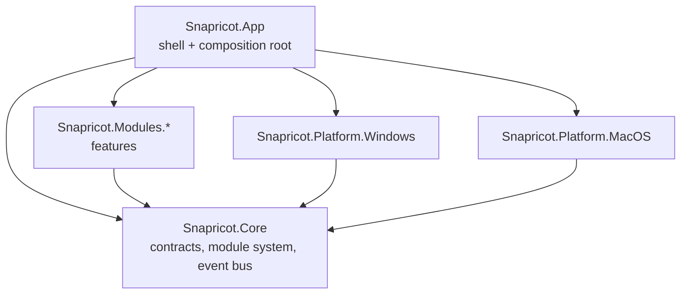

# Architecture overview

## In one paragraph

Snapricot is a thin **shell** (`Snapricot.App`) hosting independent **feature modules**. Modules depend only on
**`Snapricot.Core`**, which defines the module system, an in-process **event bus**, capture models, extension points,
and **platform interfaces**. Each OS implements those interfaces in its own **platform project**. The shell is the
composition root: it loads an explicit list of modules, builds the dependency-injection container, and turns module
contributions (sidebar pages, tray items, hotkeys) into UI. Nothing is created until it is used.

## Layers and allowed dependencies



| Project | May reference | Must not reference |
|---|---|---|
| `Snapricot.Core` | BCL, `Microsoft.Extensions.*.Abstractions` | Avalonia, OS APIs, any Snapricot project |
| `Snapricot.Modules.*` | Core, Avalonia, CommunityToolkit.Mvvm, SkiaSharp | other modules, platform projects, App |
| `Snapricot.Platform.*` | Core, OS APIs | modules, App |
| `Snapricot.App` | everything | |

The rules for Core and modules are enforced by `tests/Snapricot.Architecture.Tests`.

## Module system (ADR-0004)

```csharp
public interface ISnapricotModule
{
    string Id { get; }            // "snapricot.screenshot"
    string DisplayName { get; }
    void Register(IModuleBuilder builder);
}
```

`IModuleBuilder` exposes:

| Member | Becomes |
|---|---|
| `Services` | The module's own DI registrations |
| `AddNavItem(NavItem)` | A sidebar page; the view is created on first open |
| `AddTrayItem(TrayItem)` | An entry in the tray / menu-bar menu |
| `AddHotkey(HotkeyBinding)` | A global hotkey with a default gesture (user-rebindable in Settings → Hotkeys) |
| `AddSettingsTab(SettingsTab)` | A tab on the Settings page (built-in ids in `SettingsTabs`: general, save-to, hotkeys) |
| `AddSettingsSection(SettingsSection)` | A block of settings UI on any module's tab, stacked by order |

`NavItem.Placement` puts an entry in the main list or the bottom group (Settings, About). The shell's own contributions
(Settings page, General and Hotkeys tabs) are registered by an internal `ShellModule` through the same API.
A section targeting an unknown tab fails at startup (`UnknownSettingsTabException`).

`ModuleLoader.Load(services, modules)` runs each `Register`, rejects duplicate ids (`DuplicateContributionException`),
sorts contributions, and registers a `ModuleCatalog` singleton the shell reads. Modules are listed explicitly in
`src/Snapricot.App/Composition/InstalledModules.cs`, with no assembly scanning, so trimming and AOT stay safe.

## Extension points

| Interface | Status | Purpose |
|---|---|---|
| `ICaptureSource` | defined | A way to capture: region, window, full screen; later scrolling, delayed, webcam |
| `IAfterCaptureAction` | defined | A button in the overlay toolbar: copy, save, copy text, pin, upload |
| `IAnnotationTool` | Phase 2 | An editor tool |
| `IExportTarget` | later | Where captures go: disk, Imgur, S3, Drive |
| `IImageEffect` | later | Post-processing: background frame, rounded corners, watermark |
| `SettingsSection` / `SettingsTab` | done | Per-module settings UI |
| `ICaptureFeedback` | done (Screenshot) | Sound and notification after a capture |

Rule of thumb: when a second module needs the same kind of hook, add an extension point to Core rather than a
module-to-module dependency.

## Event bus (ADR-0005)

`IEventBus` with `Subscribe<T>` / `PublishAsync<T>`: in-process, ordered, copy-on-write (publishing doesn't lock), and
**failure-isolated** (a throwing handler is logged and skipped). Events are past-tense records in Core:

| Event | Published when |
|---|---|
| `CaptureCompleted(Image, SourceId)` | Pixels are captured, before any disk I/O |
| `CaptureSaved(Image, FilePath)` | The file is written |

Example flow, Phase 1–2: the Screenshot module captures and publishes `CaptureCompleted`. The History module (subscribed)
adds an entry, and the Editor module (subscribed) opens if the user chose Edit. Neither knows the others exist.

## Platform abstraction (ADR-0007)

`Snapricot.Core.Platform`: `IScreenCapture`, `IDesktopService`, `IHotkeyService`, `IClipboardService`,
`IAutostartService` (Run key), `IShellService` (show in folder / open), `ISoundService` (shutter sound, synthesized).
Coming later: OCR engine.

## Hotkeys and settings

- `HotkeyManager` (Core) registers every `HotkeyBinding` with the user's override or the default, reports live status
  (Active / Unavailable / Invalid / Suspended), rebinds with rollback if the new combination is taken, and suspends all
  hotkeys while a new one is recorded. Overrides persist in the `"hotkeys"` settings section.
- `ISettingsStore` (Core) persists one JSON section per module in `%APPDATA%\Snapricot\settings.json` (ADR-0012). `AppHost` registers exactly one platform using `SNAPRICOT_WINDOWS` / `SNAPRICOT_MACOS`,
which the App csproj defines depending on the build OS.

## Shell

- `App.axaml.cs` builds services, creates `MainWindow`, installs the tray, and sets `ShutdownMode.OnExplicitShutdown`
  (closing the window hides it; tray → Quit exits).
- `MainWindowViewModel` maps `ModuleCatalog.NavItems` to `NavItemViewModel`s; each creates its view once, on first selection.
- The sidebar is always rendered with the Dark theme variant (`ThemeVariantScope`).

## Threading

- The UI thread only renders and handles input. Capture, encoding, and file I/O run on the thread pool.
- After capture: put pixels on the clipboard first (fast), publish `CaptureCompleted`, then save in the background.
